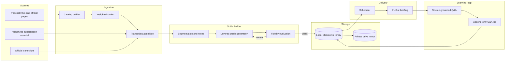

# PM Pulse: Architecture

PM Pulse is a human-in-the-loop learning pipeline. The user defines learning goals and determines what is worth mastering; the system ranks, sources, structures, verifies, delivers, and preserves the learning dialogue.

## System overview



## Component responsibilities

### Catalog and ranker

**Input:** episode metadata such as title, date, duration, guest, company, and source.

**Policy:** score each item against the configured rubric and explicit learning goals. Personal interest is retained as data but is not allowed to overwhelm interview relevance and transferability before enough preference evidence exists.

**Output:** a ranked shortlist and bounded backlog per source family.

The queue invariant is deliberate: additions replace weaker items rather than expanding the list.

### Transcript acquisition

Sourcing order:

1. Official source transcript.
2. User-supplied text from a legitimate account or subscription.
3. Local speech-to-text on legitimately accessible public audio.
4. Park the item if no authorized route exists.

Every guide records its source route and uncertainty. Local ASR limitations—especially speaker attribution, proper nouns, and rapid exchanges—remain visible.

### Guide builder

Each episode becomes a directory of small Markdown artifacts:

- executive brief;
- detailed summary;
- section-level deep dives;
- source-linked PM lessons;
- knowledge card; and
- fidelity evaluation.

Layering is a product contract, not formatting decoration. It allows the same source to serve a five-minute reading slot and a deep study session without making either experience worse.

### Fidelity evaluator

No guide enters the delivery pool without a passing evaluation.

The evaluator checks:

- a sample of factual claims against timestamps;
- every direct quotation against the transcript;
- important figures against their original context;
- the Said-versus-Read label on analytical statements; and
- whether each PM lesson is grounded in an identifiable episode moment.

Unsupported claims are corrected or removed. The evaluator does not silently repair a claim while leaving the audit trail ambiguous.

### Storage

The primary library uses plain Markdown because it is:

- portable;
- searchable;
- diffable;
- readable by humans and agents; and
- independent of a proprietary notes database.

A private drive mirror supports cross-device reading. The public GitHub repository contains templates and workflow documentation only.

### Scheduler and delivery

Each scheduled job:

1. resolves the next undelivered eligible guide;
2. confirms a passing evaluation;
3. loads the executive brief and knowledge card;
4. formats the full reading in-message; and
5. appends the outcome to a delivery log.

A successful scheduler run is not assumed to prove user delivery; delivery-channel failures remain visible and recoverable.

### Conversational tutor

Follow-up answers are grounded in the episode transcript and evaluated guide. If outside knowledge is used, the answer must identify it as outside the source.

Each exchange is appended to `qa-log.md` with a timestamp. The log is append-only so corrections and changed conclusions remain part of the learning history.

## Episode guide data model

```text
EpisodeGuide
├── source
│   ├── provenance
│   ├── acquisition route
│   └── uncertainty notes
├── transcript
├── index
├── executive_brief
├── detailed_summary
├── deep_dives[]
├── pm_lessons[]
├── knowledge_card
├── evaluation
└── qa_log[]
```

## Invariants

- A guide without an evaluation verdict of `pass` cannot be delivered.
- The transcript is the source of truth; summaries never cite other summaries.
- Q&A history is append-only.
- The queue cannot grow without an explicit capacity decision.
- Private source text is not written to the public repository.
- A missing guide produces a visible skip or substitution—not invented content.

## Tradeoffs

| Decision | Chosen | Alternative | Rationale |
|---|---|---|---|
| Runtime | Muse | Build a custom agent platform | Validate differentiated workflow first. |
| Storage | Markdown | Database or notes app | Portability and low lock-in. |
| Summary design | Layered | One universal summary | Different time budgets require different depths. |
| Trust | Evaluate before delivery | Trust first-pass generation | Inaccuracy destroys the learning product. |
| Queue | Closed list | Infinite backlog | Scarcity creates real prioritization. |
| Delivery | Full text in chat | Link-only | Removes a high-friction extra step. |
| Tutor | Source-grounded | General open-knowledge chat | Preserves the source as teacher and limits drift. |

## Failure handling

| Failure | Behavior |
|---|---|
| Guide is not ready | Report it plainly, substitute an approved item, or skip. |
| Transcript is unavailable | Park the source. Do not summarize secondary coverage as if it were primary. |
| ASR is uncertain | Record uncertainty and exclude unsupported names, quotes, or figures. |
| Evaluation fails | Return the guide for revision. |
| Delivery channel fails | Preserve run state and retry or reissue deliberately. |
| Tutor cannot answer from source | Say that the answer is outside the source. |

## Private production layout

The private guide library follows this contract:

```text
guides/<source>/<episode>/
├── source.md
├── transcript.md
├── 00-index.md
├── 01-executive-brief.md
├── 02-detailed-summary.md
├── 03-deep-dive/
├── 04-pm-lessons.md
├── knowledge-card.md
├── evaluation.md
└── qa-log.md
```

None of those source-derived artifacts are included in the public repository.
